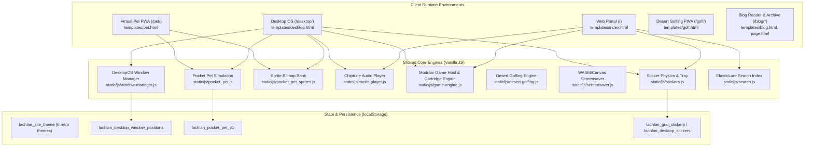
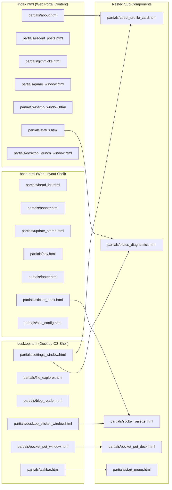

# Lachlan's World — System Architecture & Developer Guide

Welcome to the architectural specification for **Lachlan's World** (`spatoa/website`). This document provides a complete blueprint of the runtime environments, template hierarchy, JavaScript module contracts, storage schemas, and styling cascade.

---

## 1. High-Level Architecture Overview

Lachlan's World is a zero-framework, static-first web experience compiled by [Zola](https://www.getzola.org/) (Rust-based SSG) and enriched with vanilla ECMAScript, HTML5 Semantic layouts, and CSS variables.

The site provides **four primary runtime environments**:
1. **Web Portal (`/`)**: A classic two-column Web 2.0 portal with modular retro widgets, profile card, chiptune music player, LED marquee ticker, interactive screensaver canvas, and a floating sticker drawer.
2. **Desktop OS (`/desktop/`)**: A mid-2000s draggable Web OS shell with a desktop icon grid, taskbar dock, Start Menu, virtual File Explorer (`C:\`), Display Properties / Settings dialog (`Settings.exe`), and Blog Reader window.
3. **Standalone Virtual Pet PWA (`/pet/`)**: A dedicated handheld appliance simulation of a 1997 Gen-1 virtual keychain pet, featuring an authentic 32x19 dot-matrix LCD canvas, 1-bit Web Audio piezo buzzer, and offline Service Worker caching.
4. **Standalone Desert Golfing PWA (`/golf/`)**: A dedicated full-screen, landscape-locked 2D physics arcade appliance running 100% offline with zero visual website chrome, resolution-independent vector scaling, and continuous Catmull-Rom dunes.



---

## 2. Template Partials Hierarchy & Component Tree

To maintain clean separation of concerns and adhere to `AGENTS.md` guidelines, `templates/index.html`, `templates/desktop.html`, and `templates/pet.html` assemble their layouts from partials located in `templates/partials/`.

### 2.1 Partials Inclusion Map



### 2.2 Complete Partials Directory Index

| Partial Name | Environment | Included By | Description |
| :--- | :--- | :--- | :--- |
| `head_init.html` | Shared Global | `base.html`, `desktop.html`, `pet.html` | Injected early in `<head>` to read theme and wallpaper from localStorage, preventing FOUC. |
| `site_config.html` | Shared Global | `base.html`, `desktop.html`, `pet.html` | Embeds Zola configuration metadata (avatar icon, theme strings) for client scripts. |
| `banner.html` | Web Portal | `base.html` | Top vintage marquee banner with LED ticker messages from `zola.toml`. |
| `nav.html` | Web Portal | `base.html` | Portal header navigation bar, search input, and quick links (`HOME`, `BLOG`, `PET`, `GIT`, `DESKTOP`). |
| `update_stamp.html` | Web Portal | `base.html` | Retro "LAST UPDATED" marquee stamp bar. |
| `footer.html` | Web Portal | `base.html` | Bottom portal footer with license link and copyright info. |
| `about.html` | Web Portal | `index.html` | Left-column profile widget wrapper; includes `about_profile_card.html`. |
| `about_profile_card.html` | Reusable Card | `about.html`, `settings_window.html` | Renders avatar photo, bio snippet, workstation specs, and social badges. |
| `recent_posts.html` | Web Portal | `index.html` | Left-column feed of the 3 latest blog dispatches. |
| `status.html` | Web Portal | `index.html` | Right-column system telemetry status box; includes `status_diagnostics.html`. |
| `status_diagnostics.html` | Reusable Card | `status.html`, `settings_window.html` | Real-time browser agent diagnostic telemetry, connection status, and ping meter. |
| `desktop_launch_window.html`| Web Portal | `index.html` | Promotional callout button inviting users into the interactive Desktop OS. |
| `sticker_book.html` | Web Portal | `base.html` | Floating bottom sticker tray panel for dragging stickers onto the portal page. |
| `sticker_palette.html` | Reusable Card | `sticker_book.html`, `desktop_sticker_window.html` | Palette of collectible 2000s stickers (Y2K badges, animated GIFs, retro logos). |
| `game_window.html` | Shared Window | `index.html`, `desktop.html` | Modular retro CRT monitor window hosting hot-swappable game cartridges (Desert Golfing, Starfield Screensaver). |
| `desert_golfing_window.html`| Desktop OS | `desktop.html` | Dedicated Desert_Golfing.exe application window with 2D physics simulation and endless dunes. |
| `winamp_window.html` | Shared Window | `index.html`, `desktop.html` | Authentic Winamp v2-inspired procedural Web Audio 8-bit chiptune synthesizer and visualizer. |
| `gimmicks.html` | Shared Window | `index.html`, `desktop.html` | Retro interactive gimmick box (random fortune, visitor prank, fake installer). |
| `pocket_pet_deck.html` | Reusable Card | `pocket_pet_window.html`, `pet.html` | Hardware LCD virtual pet deck with 32x19 canvas screen and 3-button control pad (A, B, C). |
| `pocket_pet_window.html` | Desktop OS | `desktop.html` | Desktop window wrapper for `pocket_pet_deck.html`. |
| `file_explorer.html` | Desktop OS | `desktop.html` | Retro Win32 File Explorer window with virtual directory tree (`C:\`), search, and sorting. |
| `blog_reader.html` | Desktop OS | `desktop.html` | Embedded blog reader window allowing full post reading without leaving Desktop OS. |
| `settings_window.html` | Desktop OS | `desktop.html` | Display Properties dialog (`Settings.exe`) with wallpaper picker, theme chooser, and diagnostics tabs. |
| `desktop_sticker_window.html`| Desktop OS | `desktop.html` | Desktop sticker book window for placing stickers onto the OS desktop wallpaper. |
| `taskbar.html` | Desktop OS | `desktop.html` | Fixed bottom taskbar with Start button, active window task buttons, and system clock tray. |
| `start_menu.html` | Reusable Card | `taskbar.html` | Pop-up Start Menu listing installed desktop applications and external system shortcuts. |

---

## 3. JavaScript Module Architecture & Global Contracts

All scripts are written in vanilla ECMAScript (ES6+) without npm dependencies or bundlers. They load asynchronously with `defer`. To coordinate actions without tight coupling, modules expose specific contracts under `window`.

### 3.1 Global API Registry (`window.*`)

| Global Property | Defined In | Consumed By | Purpose & Signature |
| :--- | :--- | :--- | :--- |
| `window.DesktopOS` | `window-manager.js` | Desktop apps, taskbar, icons | Main desktop OS controller (`openApp(id)`, `closeApp(id)`, `minimizeApp(id)`, `focusApp(id)`). |
| `window.openDesktopWindow(id)` | `window-manager.js` | HTML links, shortcuts | Convenience wrapper: opens and focuses the specified window ID. |
| `window.closeDesktopWindow(id)`| `window-manager.js` | Dialog close buttons | Convenience wrapper: closes the specified window ID. |
| `window.minimizeDesktopWindow(id)`| `window-manager.js` | Window chrome buttons | Convenience wrapper: minimizes the specified window ID. |
| `window.openDesktopArticle(slug)` | `window-manager.js` | File Explorer, Blog links | Switches active article in `blog_reader.html` and brings it into focus. |
| `window.switchSiteTheme(themeId)` | `theme-switcher.js` | Top bar, Settings.exe | Switches site theme class on `document.body` and persists to `lachlan_site_theme`. |
| `window.stopMusicPlayback()` | `music-player.js` | `window-manager.js` | Pauses procedural audio playback when Winamp window is closed or mobile isolated. |
| `window.startScreensaver()` | `screensaver.js` | `window-manager.js` | Starts/resumes starfield canvas rendering when Game window is opened. |
| `window.stopScreensaver()` | `screensaver.js` | `window-manager.js` | Pauses canvas rendering when Game window is closed or mobile isolated. |
| `window.clearDesktopStickers()` | `stickers.js` | Settings.exe, Recycle Bin | Removes all placed wallpaper stickers and wipes `lachlan_desktop_stickers`. |
| `window.applyStickerMotionPreference()` | `stickers.js` | Settings.exe | Re-reads `lachlan_sticker_motion` and toggles CSS floating animations. |
| `window.toggleStickerMotionPreference()`| `stickers.js` | Settings.exe | Toggles motion preference (`enabled` / `disabled`) and saves to storage. |
| `window.StickerEngine` | `stickers.js` | External extensions | Public API for sticker management (`getActiveContainer()`, `getStorageKey()`). |
| `window.PocketPetSprites` | `pocket_pet_sprites.js`| `pocket_pet.js` | 2D bitmask dictionary for all 32x19 virtual LCD sprite graphics. |
| `window.Pocket_Pet` | `pocket_pet.js` | Pet UI, standalone PWA | Virtual pet simulation engine (lifecycle, feeding, hygiene, minigame loop). |
| `window.GameEngine` | `game-engine.js` | Web Portal, Desktop OS | Cartridge registry & container host (`registerCartridge`, `mountCartridge`, `cycleNextCartridge`). |
| `window.DesertGolfing` | `desert-golfing.js` | GameEngine, DesktopOS | Desert Golfing physics engine factory (`createInstance(canvas)`, `getState()`). |
| `window.PWARuntime` | `pwa-runtime.js` | Standalone PWAs (/golf/, /pet/) | Reusable PWA client runtime (`registerServiceWorker()`, `isStandalone()`, `bindViewport()`). |
| `window.VisitCounter` | `visit-counter.js` | Status widget | Calculates visitor visit count and formats retro mechanical odometer digits. |
| `window.LegitSoftware` | `gimmicks.js` | Gimmicks window | Interactive fake software setup wizard minigame. |
| `window.randomizeWordArt()` | `wordart.js` | Gimmicks window | Re-rolls gradient style on vintage WordArt elements. |
| `window.SEARCH_CONFIG` | `base.html` (inline) | `search.js` | URLs and localized strings for ElasticLunr search index execution. |

---

## 4. LocalStorage & SessionStorage Schema

All client state is isolated under the `lachlan_` prefix to prevent collision with other applications.

| Storage Key | Storage Type | Data Type | Default Value | Owning Module | Description |
| :--- | :--- | :--- | :--- | :--- | :--- |
| `lachlan_site_theme` | `localStorage` | `string` | `'windows'` | `theme-switcher.js` | Currently active theme (`windows`, `paper`, `midnight`, `cyber-y2k`, `candy-2000`, `scene-punk`). |
| `lachlan_desktop_mode` | `localStorage` | `string` | `'false'` | `window-manager.js` | Desktop mode active flag (`'true'` / `'false'`). |
| `lachlan_desktop_window_positions` | `localStorage` | `JSON Object` | `{}` | `window-manager.js` | Map of saved `{ x, y }` pixel coordinates for each draggable desktop window. |
| `lachlan_window_states` | `localStorage` | `JSON Object` | `{}` | `window-manager.js` | Legacy compatibility mirror for window coordinates. |
| `lachlan_custom_wallpaper` | `localStorage` | `string` | `null` | `window-manager.js` | Custom wallpaper URL or data URI selected in Settings.exe. |
| `lachlan_custom_wallpaper_fit` | `localStorage` | `string` | `'center'` | `window-manager.js` | Custom wallpaper display mode (`'center'`, `'tile'`, `'stretch'`). |
| `lachlan_grid_stickers` | `localStorage` | `JSON Array` | `[]` | `stickers.js` | Placed sticker records on Web Portal (`{ id, src, x, y, rot }`). |
| `lachlan_desktop_stickers` | `localStorage` | `JSON Array` | `[]` | `stickers.js` | Placed sticker records on Desktop OS wallpaper canvas. |
| `lachlan_stickers` | `localStorage` | `JSON Array` | `[]` | `stickers.js` | Legacy fallback key for portal sticker records. |
| `lachlan_sticker_motion` | `localStorage` | `string` | `'enabled'` | `stickers.js` | Floating CSS motion toggle (`'enabled'` or `'disabled'`). |
| `lachlan_grid_sticker_drawer_open` | `localStorage` | `string` | `'false'` | `stickers.js` | Drawer open/closed state on portal layout. |
| `lachlan_pocket_pet_v1` | `localStorage` | `JSON Object` | `{}` | `pocket_pet.js` | Virtual pet state (species, stage, hunger, happiness, discipline, age, sickness, poo, lastTick). |
| `lachlan_pocket_pet_sound` | `localStorage` | `string` | `'active'` | `pocket_pet.js` | Sound toggle for 1-bit piezo buzzer (`'active'` or `'muted'`). |
| `lachlan_desert_golfing_v1`| `localStorage` | `JSON Object` | `{}` | `desert-golfing.js` | Endless physics golf state (`hole`, `strokes`, `totalStrokes`, `ball`, `seed`, `sound`). |
| `lachlan_active_portal_game`| `localStorage`| `string` | `null` | `game-engine.js` | ID of the active cartridge mounted on the Web Portal interactive canvas. |
| `lachlan_pet_skin` | `localStorage` | `string` | `'windows'` | `pet-standalone.js` | Visual housing plastic skin for the standalone pet appliance. |
| `lachlan_user_visits` | `localStorage` | `string` | `'1'` | `visit-counter.js` | Total persistent visit counter number. |
| `lachlan_wordart_style` | `localStorage` | `string` | `'0'` | `wordart.js` | Current active vintage WordArt gradient preset index. |
| `lachlan_session_visited` | `sessionStorage`| `string` | `'true'` | `visit-counter.js` | Session guard flag preventing duplicate visit increments during navigation. |
| `lachlan_last_gimmick_idx` | `sessionStorage`| `string` | `'0'` | `gimmicks.js` | Stores last selected gimmick tab index across session navigation. |

---

## 5. CSS Architecture & Style Cascade

Styling is implemented in modular vanilla CSS without preprocessors. All styling starts at `static/css/style.css` which orchestrates imports:

```text
style.css (Entry Point)
├── tokens.css (Design tokens & 6-theme color definitions)
├── base.css (Typography, retro bevel utilities, reset)
├── layout.css (Portal 2-column grid & responsive breakpoints)
├── desktop_mode.css (Desktop OS shell, window chrome, and layout)
└── components/
    ├── banner.css
    ├── nav.css
    ├── panel.css
    ├── desktop_launch.css
    ├── screensaver.css
    ├── desert_golfing.css
    ├── winamp.css
    ├── search.css
    ├── blog.css
    ├── stickers.css
    ├── footer.css
    ├── gimmicks.css
    ├── pocket_pet_tokens.css
    ├── pocket_pet.css
    ├── pet_standalone.css
    └── cursor.css
```

### 5.1 Design Tokens & Theming
Variables in `tokens.css` are scoped under body classes:
- `.theme-paper` (Default warm light)
- `.theme-windows` (Classic Win32 gray & navy)
- `.theme-midnight` (High-contrast OLED dark)
- `.theme-cyber-y2k` (Electric lime & purple dark)
- `.theme-candy-2000` (Glossy aqua & tangerine Web 2.0)
- `.theme-scene-punk` (Pitch black & hot pink neon)

Always use CSS variables (`var(--panel-bg)`, `var(--panel-border)`, `var(--bevel-light)`, `var(--bevel-dark)`) rather than hardcoding hex values.

---

## 6. Developer Workflows & Recipes

### How to Add a New Window App to Desktop OS
1. Create `templates/partials/<feature>_window.html`:
   ```html
   <section class="panel desktop-window" id="my-feature-window"
            data-app-id="my-feature-window"
            data-app-title="MyFeature.exe"
            data-app-icon="🗔"
            data-default-x="200"
            data-default-y="100">
     <div class="panel-header">★ My Feature ★</div>
     <div class="panel-body">...</div>
   </section>
   ```
2. Include the partial inside `templates/desktop.html` within `<div class="desktop-windows-layer">`.
3. `DesktopOS.autoDiscover()` in `window-manager.js` will automatically detect the window, generate a desktop shortcut icon, and add it to the Start Menu.

### How to Add a New Portal Widget
1. Create `templates/partials/<feature>.html`.
2. Include it inside `templates/index.html` in either `.left-col` or `.right-col`.
3. Add styles to `static/css/components/<feature>.css` and import in `static/css/style.css`.

### How to Center Text in Blog Posts
In any Markdown post file, wrap the text with `[center]...[/center]` tags:
```markdown
[center]This text will be rendered in the center of the article.[/center]
```
The template automatically parses this at build time into centered text with zero HTML required.

### How to Verify Static Site Builds
```bash
nix develop --command zola build
```
Builds should complete in under 50ms with 0 errors.
