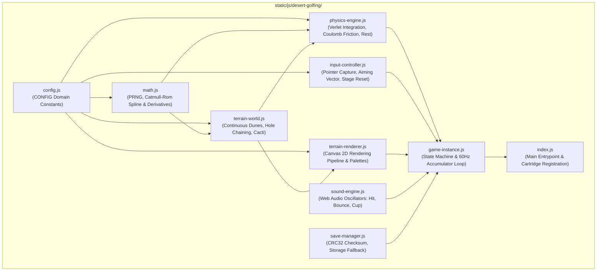
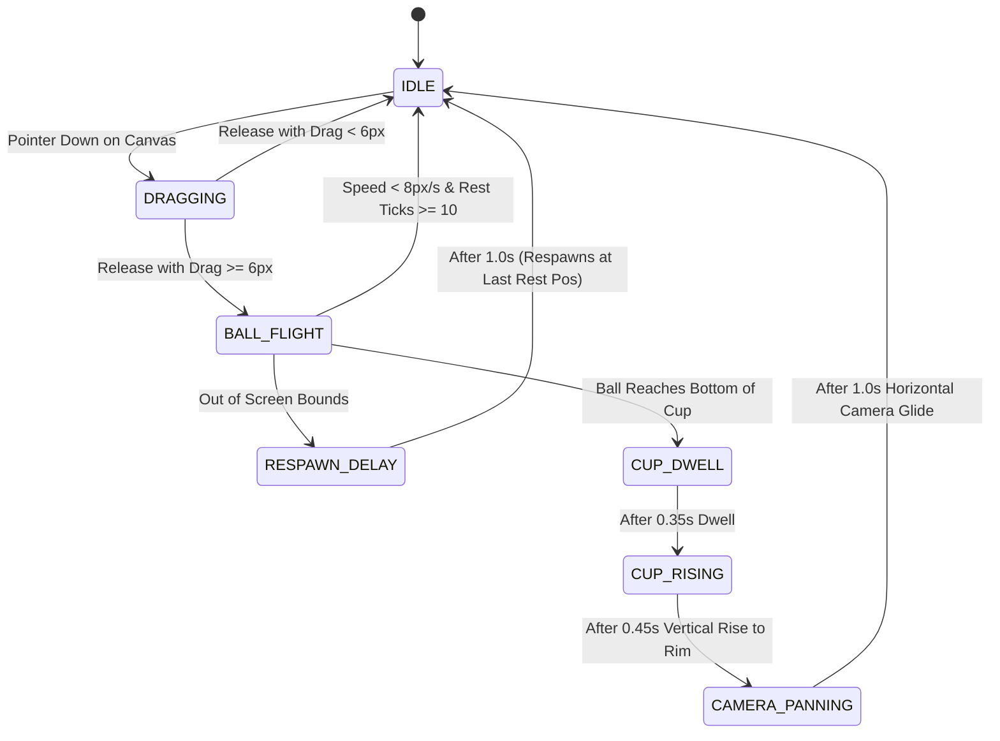

# Desert Golfing Engine — Subsystem Specification & Architecture

This directory (`static/js/desert-golfing/`) contains the modular source code and technical specifications for the **Desert Golfing** continuous 2D dune physics engine in **Lachlan's World** (`spatoa/website`).

These modules are dedicated strictly to Desert Golfing and are encapsulated to prevent leaking internal physics or spline math into the broader site architecture.

---

## 1. Subsystem Architecture & Module Breakdown

The subsystem is decomposed into 9 specialized single-responsibility modules:



### Module Directory Index

| File | Purpose | Lines of Code | Key Exports |
| :--- | :--- | :--- | :--- |
| [`config.js`](file:///home/spatoa/Documents/website/static/js/desert-golfing/config.js) | Centralized, frozen constants for physics, world geometry, slingshot, palettes, and timing. | ~130 | `CONFIG` |
| [`math.js`](file:///home/spatoa/Documents/website/static/js/desert-golfing/math.js) | Pure deterministic 32-bit math, Mulberry32 PRNG, Hash32, Catmull-Rom splines, and derivatives. | ~140 | `hash32`, `mulberry32`, `evaluateCatmullRom`, `evaluateCatmullRomSlope`, `smoothstep`, `interpolateColor`, `clamp` |
| [`save-manager.js`](file:///home/spatoa/Documents/website/static/js/desert-golfing/save-manager.js) | IEEE 802.3 CRC32 checksum generation, state serialization, legacy format migration, and fallback storage. | ~180 | `SaveManager.load`, `SaveManager.save`, `SaveManager.computeCRC32`, `SaveManager.clear` |
| [`sound-engine.js`](file:///home/spatoa/Documents/website/static/js/desert-golfing/sound-engine.js) | Diegetic procedural audio synthesis using the Web Audio API without external audio files. | ~130 | `SoundEngine.playHit`, `SoundEngine.playBounce`, `SoundEngine.playCup` |
| [`terrain-world.js`](file:///home/spatoa/Documents/website/static/js/desert-golfing/terrain-world.js) | Procedural infinite continuous dune world generator, Catmull-Rom heightmaps, green flattening, and hole chaining. | ~230 | `TerrainWorld.createTerrainWorld` |
| [`physics-engine.js`](file:///home/spatoa/Documents/website/static/js/desert-golfing/physics-engine.js) | Velocity Verlet integration, 2D Coulomb friction on sand, downhill gravity scaling, anti-creep bite, and settling. | ~280 | `PhysicsEngine.stepVerlet`, `resolveGroundCollision`, `checkCupEntry`, `isRestingCandidate` |
| [`input-controller.js`](file:///home/spatoa/Documents/website/static/js/desert-golfing/input-controller.js) | Unified PointerEvent controller with pointer capture, slingshot aim calculation, and mobile gesture cancellation. | ~230 | `InputController.createInputController`, `isHoleNumberTapped` |
| [`terrain-renderer.js`](file:///home/spatoa/Documents/website/static/js/desert-golfing/terrain-renderer.js) | Layered Canvas 2D render pipeline: sky, sand polygon with subpixel U-trench, cup cavity, pin flag, vegetation, and HUD. | ~260 | `TerrainRenderer.renderFrame`, `getPaletteColors` |
| [`game-instance.js`](file:///home/spatoa/Documents/website/static/js/desert-golfing/game-instance.js) | Game instance lifecycle coordinator, 7-state finite state machine, and fixed-timestep 60Hz loop. | ~360 | `GameInstance.createGameInstance` |
| [`index.js`](file:///home/spatoa/Documents/website/static/js/desert-golfing/index.js) | Aggregator module assembling submodules, exposing `window.DesertGolfing`, and registering with `GameEngine`. | ~60 | `DesertGolfing` |

---

## 2. Mathematical Specifications

### 2.1 Pseudo-Random Number Generation (PRNG)
- **Hash32**: Uniform bit-mixing integer hash function used to derive unique 32-bit seeds for each stage index and control point:
  $$x = ((seed \oplus index) \oplus ((seed \oplus index) \gg 16)) \times \text{0x45D9F3B}$$
- **Mulberry32**: Fast 32-bit PRNG that outputs high-entropy floating point values in $[0, 1)$ without seed degeneration.

### 2.2 Continuous Spline & Slope
Ground elevation is defined by a uniform Catmull-Rom cubic Hermite spline passing through control points spaced at $\Delta x = 40.0$:
$$P(t) = \frac{1}{2} \left[ 2p_1 + (-p_0 + p_2)t + (2p_0 - 5p_1 + 4p_2 - p_3)t^2 + (-p_0 + 3p_1 - 3p_2 + p_3)t^3 \right]$$

The instantaneous slope ($\frac{dy}{dx}$) used for surface normals is computed from the exact first derivative of the spline:
$$\frac{dy}{dt} = \frac{1}{2} \left[ (-p_0 + p_2) + 2(2p_0 - 5p_1 + 4p_2 - p_3)t + 3(-p_0 + 3p_1 - 3p_2 + p_3)t^2 \right]$$
$$\frac{dy}{dx} = \frac{1}{\Delta x} \frac{dy}{dt}$$

---

## 3. Physics Simulation & Coulomb Sand Interaction

The physics loop runs at a fixed 60Hz time step ($\Delta t = \frac{1}{60} \text{ s}$):

### 3.1 Velocity Verlet Integration
$$\mathbf{x}_{t+\Delta t} = \mathbf{x}_t + \mathbf{v}_t \Delta t + \frac{1}{2} \mathbf{a}_t \Delta t^2$$
$$\mathbf{v}_{t+\Delta t} = \mathbf{v}_t + \frac{1}{2} (\mathbf{a}_t + \mathbf{a}_{t+\Delta t}) \Delta t$$
where $\mathbf{a} = \mathbf{g} - C_d \|\mathbf{v}\| \mathbf{v}$.

### 3.2 Coulomb Friction & Sand Dynamics
- **Normal Restitution ($e = 0.20$)**: High-velocity impacts ($|v_n| > 140 \text{ px/s}$) rebound with heavily damped inelastic restitution; low-velocity impacts deaden immediately into surface rolling contact.
- **Slope Gravity Coupling**: Scaled tangential downhill acceleration ($0.38 \cdot g \cdot \sin\theta$) prevents runaway bullet speeds down steep dunes.
- **Angle of Repose ($\mu_s = 0.62 \approx 31.8^\circ$)**:
  - **Sticking**: If $\tan\theta \le \mu_s$ and speed is below $8.0 \text{ px/s}$, the ball stops completely and locks position.
  - **Sliding**: If $\tan\theta > \mu_s$, the ball accelerates down the crest.
- **Anti-Creep Progressive Static Bite**: When rolling downhill on shallow, stable slopes ($\tan\theta \le \mu_s$), rolling resistance dynamically ramps up below $55 \text{ px/s}$ to strictly exceed downhill pull by at least $50 \text{ px/s}^2$, eliminating everlasting terminal crawls.

---

## 4. Finite State Machine (FSM)

The game instance transitions through 7 distinct states:



---

## 5. Persistence Schema & Checksum Verification

Game progress is saved under `lachlan_desert_golfing_v1` in `localStorage`:

```json
{
  "version": 1,
  "master_seed": 894312,
  "current_hole": 42,
  "total_strokes": 98,
  "sound": "active",
  "ball_state": {
    "pos_x": 16420.312,
    "pos_y": 182.405,
    "vel_x": 0,
    "vel_y": 0
  },
  "last_rest_pos": {
    "x": 16420.312,
    "y": 182.405
  },
  "checksum": "a4f891b2"
}
```

- Coordinate floats are rounded to 3 decimal places to prevent serialization drift.
- Checksums are verified using standard IEEE 802.3 CRC32 before loading.
- If storage is unavailable or quota is exceeded, an in-memory session cache serves as seamless fallback.

---

## 6. Verification & Automated Testing

To run the automated verification suite:
```bash
nix develop --command node scripts/test-desert-golfing.js
```

The modular components in `static/js/desert-golfing/` are loaded directly by templates (`templates/partials/desert_golfing_scripts.html`) without requiring any bundler or build step.
